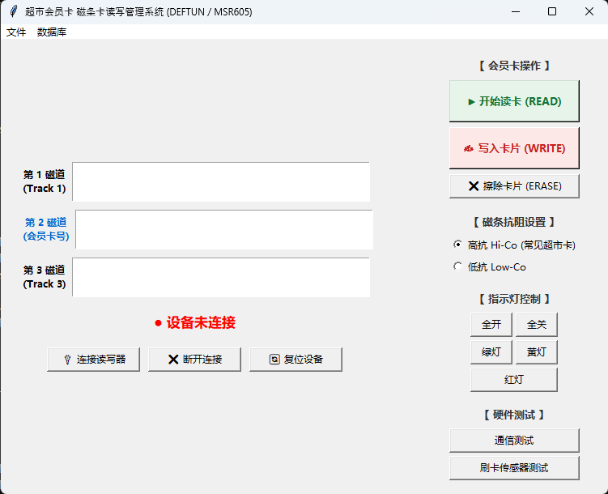

# MagCard Studio - 超市会员卡与磁条卡读写管理系统

  

  
  
  
  
  

> 一款基于 Python + Tkinter 的磁条卡读写管理桌面应用，兼容 DEFTUN MSR-X6 / MSR605 系列设备。适用于超市商超、实体商户的磁条会员积分卡批量制卡、读取、写入与本地数据库管理。

---
- **硬件兼容**: MSR605 / DEFTUN MSR-X6 / MSR-X6BT 及同协议磁条卡读写器
- **支持平台**: Windows / Linux (提供 Windows 免安装开箱即用 EXE)
- **开发语言**: Python 3 (Tkinter + PySerial)
- **开源协议**: 见 [LICENSE](LICENSE) 文件 (致敬并衍生自原作者 Manwinder Sidhu 开源项目)

---

## 一、依赖库

1. **`pyserial`**：用于电脑与 MSR605 / DEFTUN 读写器之间的串口通信 ([https://github.com/pyserial/pyserial](https://github.com/pyserial/pyserial))
2. **`tkinter`**：用于图形界面显示 (Python 标准库自带)

---

## 二、硬件说明

**MSR605**（及兼容的 DEFTUN MSR-X6 / X6BT 等）是一款磁条卡读写器/编码器，能够读写大众日常使用的标准磁条卡（如会员卡、积分卡、储值卡、信用卡等，即背面带有黑色或彩色磁条的卡片）。作者在 eBay 上购买该设备，主要看重其在网络上有非常完善的开发文档。

---

## 三、项目背景与介绍

网络上虽然有少数 MSR605 的开源项目，设备本身也有一份非常详细的官方编程手册（[MSR605 开发者手册](https://www.triades.net/downloads/MSR605%20Programmer's%20Manual.pdf)）。

作者创建该项目的初衷是因为父母的店铺需要制作**会员积分卡**，但不想花费昂贵的成本采购商业发卡系统。作者成功开发了该程序并为其店铺稳定服务了数年。作者于 2015 年 4 月立项，历经测试和完善后于 2015 年 8 月正式开源到 GitHub，目的是为社区弥补“缺乏易用图形界面（GUI）”的空白（虽然机器附带出厂软件，但功能较为单一）。

### 本项目包含的功能：
* **读卡、写卡与擦除**：支持 1 / 2 / 3 磁道的完整读写与清空。
* **硬件诊断与指示灯控制**：支持通信测试、刷卡传感器感应测试、RAM 测试以及各色 LED 灯光开关。
* **本地数据库存储**：读出的卡片数据可自动记录并保存到本地 SQLite 数据库中，方便制卡与会员信息建档。
* **高度可扩展**：您可以直接复用后端的串口驱动类库，接入您自己的收银系统或会员系统。

### 会员积分卡制作示例：
例如制作超市会员积分卡时，可以生成唯一的会员卡号（通常写入到第 2 磁道 Track 2），将卡号保存到数据库后，通过本程序将卡号写入空白磁条卡中。磁条卡遵循 ISO 7811 标准，项目中提供了 `isoStandardDictionary` 类，内置了每个磁道允许写入的字符集校验规范。

*(注：本程序主要实现了应用最广泛的 ISO 标准读写模式，未包含底层原始电平 Raw Read / Raw Write，因其已能满足绝大多数商户与会员卡业务需求。)*

---

## 四、文件结构说明

* **[`GUI.py`](GUI.py)**：图形界面主程序，提供可视化的读卡、写卡、擦除及数据库查看窗口。
* **[`MSR605Test.py`](MSR605Test.py)**：硬件自检脚本，用于对读写器的各项底层指令与硬件模块进行逐项测试。
* **[`cardReader.py`](cardReader.py)**：Python 与 MSR605 通信的核心接口类，负责通过串口（Serial）发送 ESC 控制指令并解析硬件返回的数据包。
* **[`isoStandardDictionary.py`](isoStandardDictionary.py)**：包含 ISO 7811 标准字符集字典（磁道 2 和磁道 3 采用相同的标准规范），并提供磁道字符合法性检测函数。
* **[`cardReaderExceptions.py`](cardReaderExceptions.py)**：异常处理模块，封装了 MSR 硬件返回的各类错误状态码与异常类型。
* **[`超市会员卡读写系统.exe`](超市会员卡读写系统.exe)**：已打包好的 Windows 独立免安装程序，双击即可运行。

---

## 五、已知问题 (Bugs)

* *(暂无已知严重缺陷)*
